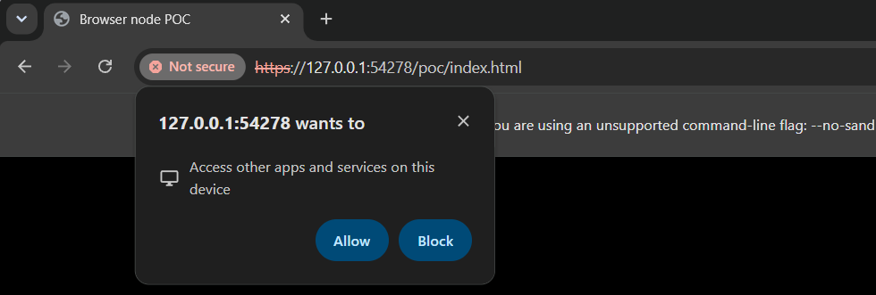

# P5: an existing node from a static origin

Date: 2026-11-05. Records: `P5-M-2026-11-05.json` for scenarios (a), (d), (e), (f), (g) and (h); `P5LNA-S-2026-11-05.json` for scenario (b), headless; `P5LNAH-S-2026-11-05.json` for (b) headed (second round); `P5R-none-2026-11-06-o2.json`, the O2 record.

Verdict: **GO**, with one item not measured: the open-time comparison with the desktop's own node arm, which belongs to the manual O2 record.

## Question

A page served from a static origin, with nothing else running, must use an unmodified `plexora node serve` through `/node/v1` end to end. Can it do so with the same bytes the desktop receives? And are the browser's permission and CORS rules workable, with nothing on BioCognia's servers?

Everything here is on loopback, on one machine. The O2, ERIS and GCP records (investigation §8.4) need a person at the Duo prompt and are not part of this run.

## (a) The protocol, end to end (Measured)

The page is the primary. It:
1. reads `/hello` and the image geometry;
2. fetches 20 random tiles, each in HD and in 8-bit WebP;
3. fetches the same 20 HD tiles in one `/batch` POST, sent as `text/plain`, so it needs no preflight;
4. reads stats and the GMM;
5. pushes the table's read spec (`POST /table/cells/load`) and reads `all_cells` (202,049 cells), `describe` and `rows`.

The driver then makes the same requests outside the browser. Those are the bytes the desktop primary receives and forwards unchanged.

| Check | Result |
|---|---|
| HD tiles, SHA-256 equal to outside the browser | 20/20 |
| WebP tiles, SHA-256 equal | 20/20 |
| batch bodies equal the single requests | 20/20 |
| `all_cells` bytes equal | yes |
| `describe` bytes equal | yes |
| headers the page can read | `X-Plexora-Generation`, `X-Plexora-Resource`, `Server-Timing` |

Timings: hello 138 ms (the first request warms the node), a 20-tile batch 248 ms, stats and GMM 403 ms, table load 230 ms, all_cells 393 ms.

The viewer half of (a) is the node arm of P1 and P2. There a static page drew the node's tiles through the product renderer, and every tour step reached full.

## (b) Chrome's Local Network Access (Measured)

The test runs on Chrome 156. The static origin is marked **public** with `--ip-address-space-overrides`, standing in for plexoraapp.com. The page fetches a loopback node and the loopback connector stub, over https (self-signed) and over http. It does this with the permission left to the browser, then granted through the DevTools protocol.

| Page | Permission | Plain fetch | `targetAddressSpace: "loopback"` | `"local"` |
|---|---|---|---|---|
| public, https | not granted (headless denies the prompt) | blocked | blocked | blocked |
| public, https | granted | **ok** | **ok** | blocked |
| public, http | not granted | blocked | blocked | blocked |
| public, http | granted | ok | ok | blocked |
| loopback (no override) | either | ok | ok | blocked |

The node and the connector stub behave the same way in every case.

- **The refusal reads** "Permission was denied for this request to access the `loopback` address space". Chrome 156 asks for `loopback-network`, which is separate from `local-network`; `local-network-access` reports the same state.
- **Once granted, nothing is needed from the server.** The node, which sends no `Access-Control-Allow-Private-Network` header and no private-network preflight answer, is read like the stub, which does send them. The private-network preflight is gone from Chrome. The planned node addition for it (investigation §6.5) is not needed.
- **`targetAddressSpace` must name the right space.** "local" for a loopback address is refused. The plain fetch also works once the permission is granted, so the option is a declaration, not a key.
- **What a user sees** is one prompt per origin. Headless cannot show it; the headed run below does.

**Headed (`P5LNAH-S-2026-11-05.json`, second round).** The same public https page in a visible Chrome 156 window, with nothing granted, starts one loopback fetch (`targetAddressSpace: "loopback"`). The window was on screen for about ten seconds.



- **The fetch is held, not refused.** Three seconds in, it is still pending: the permission state is `prompt`, and a bubble anchored to the address bar asks "127.0.0.1:PORT wants to — Access other apps and services on this device", with Allow and Block. Headless denies the same request at once, which is all the first round could see.
- **Granting the permission over CDP did not release the held fetch:** it was still pending three seconds later. New fetches after the grant succeeded (plain and `loopback`; `local` refused, as headless).
- **For the pairing page:** say what the prompt will ask before the first loopback fetch, and retry after it is answered rather than waiting on the first request. The wording to quote is the bubble's.
- The record was made before the second round's code commit (`9a2b1912-dirty`); the handler is unchanged in that commit.

## (d) Cross-origin isolation (Measured)

The page is served with COOP `same-origin` and three COEP settings. The node sends no `Cross-Origin-Resource-Policy`.

| COEP | Isolated | `fetch` (CORS) | XHR (OSD's loader) | `` no-cors | `` |
|---|---|---|---|---|---|
| require-corp | yes | ok | ok | **blocked** | ok |
| credentialless | yes | ok | ok | ok | ok |
| none | no | ok | ok | ok | ok |

- **The viewer's paths need no CORP from a node.** Fetch, XHR and the decode workers are all CORS reads, and those survive `require-corp`. Only a plain no-cors `` is blocked, and the viewer uses none for node data.
- **COOP/COEP would cost nodes nothing.** The planned CORP stamp is not needed, and isolation is open to DuckDB threads later.

## (e) A node restart (Measured)

The page polls `/health` every 100 ms while the driver stops the node and restarts it on the same port.

Timeline (ms): up 5 → down 2833 → **up 11235** (same token) → down 15918 → **refused 22328** (new token).
- **Same token:** the page recovers on its own. The gap is the node's own start-up, about 7 s here.
- **New token:** every request is refused with 403. The page has to pair again (connector or pairing link).

## (f) `--allow-origin` spellings (Measured)

| `--allow-origin` | Page loaded from | Reached |
|---|---|---|
| `http://127.0.0.1:P` | 127.0.0.1 | yes |
| `http://localhost:P` | localhost | yes |
| `http://127.0.0.1:P` | localhost | **no** |
| `http://localhost:P` | 127.0.0.1 | **no** |
| `http://127.0.0.1:P/` | 127.0.0.1 | yes (a trailing slash is tolerated) |

`127.0.0.1` and `localhost` are two origins. A launcher must name the one the page is served from, or both.

## (g) Pairing with a connector (Measured)

`connector_stub.py` answers the minimal connector's loopback API (`/connector/v1/hello, profiles, connect, status, disconnect`) without the SSH. It prints a pairing link `…/poc/index.html#pair=127.0.0.1:<port>:<token>`, and the page opened from it does the following:
1. reads the fragment, which is never sent to a server;
2. keeps the connector in IndexedDB;
3. clears the address bar (`history.replaceState`): the fragment is empty afterwards;
4. asks `hello` without the token (200, "not paired") and `profiles` without it (**403**);
5. asks `profiles` with it (200), then `connect` (200 in 52 ms);
6. reads `/hello` from the node the connector handed back (api_version 1).

## (h) The node serving the app (Measured)

`serve_static.py --rnode` plays Open OnDemand: `/rnode/<host>/<port>/app/…` serves the static build, and every other `/rnode/<host>/<port>/…` path is forwarded to the node.

- The page was loaded at `http://127.0.0.1:P/rnode/127.0.0.1/<node>/app/poc/index.html`, and the node ran with **no `--allow-origin` at all**.
- The page reached `/hello`, opened the image, and the viewer reached full in 203 ms with pixels on the canvas.
- The product files loaded from under the prefix, with `PLEXORA_BASE_URL` resolved at runtime to `/rnode/127.0.0.1/<node>/app/repo/plexora`.

## Thresholds

| Threshold | Measured | |
|---|---|---|
| tiles identical to the desktop route | 40/40 + batch | pass |
| table ops identical | all_cells, describe | pass |
| restart recovery (same token) | yes | pass |
| connector pairing | yes | pass |
| node-served app under a prefix | yes | pass |
| headed: a public page's loopback fetch is held by a prompt, and works once granted | yes, yes | pass |
| O2: the same protocol checks against a node in an O2 job | 5/5 identical (P5R) | pass |
| open C1 ≤ 1.2× the desktop node arm | — | not measured (needs the desktop app on the same node) |
| STOP: a primary-only capability with no node route | none found in these routes | |

## The remote records: O2 done, ERIS and GCP to make

`bench/p5remote.mjs` (`P5R`) runs (a) against a node that is already up. It starts nothing but the static page, reads the token from `POC_NODE_TOKEN`, never writes it to the record, and records the round trip. It first waits until each channel's 8-bit tiles stop changing: a node's first 8-bit tiles of a channel are drawn with a provisional window until its background window scan finishes, so a page and a comparison fetched a few seconds apart can see different (both correct) bytes. HD tiles do not change.

**O2 (`P5R-none-2026-11-06-o2.json`): GO.**

- **The node:** Plexora 0.0.28 (the released version installed on O2), not this checkout. It ran in a SLURM job (short partition, 8 cores, 32 GB) on a compute node. It served NLU337 (11 GB OME-TIFF, 67815 × 53096, 8 levels) and its 1,375,578-cell table from `/n/scratch`.
- **The set-up** (`bench/o2/`):
  - `poc_node.sbatch` runs from a private folder (mode 700). The token goes from a mode-600 file into the environment, never onto a command line; the node binds the compute node's loopback and allows exactly the page's origin.
  - `o2_session.sh` makes **one** ssh connection, from WSL with the benchmark key. It carries the tunnel, hands the token to a private local file, and cancels the job when it closes. On O2 every new session is a login and can be a Duo request, so polling, the token copy, the tunnel and the cancel all ride that one connection.
- **The page:** this checkout's static page in Chrome 156 on this machine, over its own network connection to O2.

| Check | Result |
|---|---|
| HD tiles, SHA-256 equal to the same requests outside the browser | 20/20 |
| 8-bit WebP tiles equal | 20/20 |
| batch bodies equal the single requests | 20/20 |
| `all_cells` bytes equal (1,375,578 cells) | yes |
| `describe` bytes equal | yes |

| Timing (ms) | |
|---|---|
| round trip (`/health`, outside the browser), p50 / p95 | 46 / 57 |
| `/hello` from the page | 15 |
| one HD tile, p50 / p95 | 66 / 98 |
| one 8-bit tile, p50 / p95 | 70 / 124 |
| 20 HD tiles in one batch | 560 |
| stats + GMM, first ask | 2854 |
| table load (the page pushes the read spec) | 957 |
| `all_cells`, 1.38 M cells | 2639 |
| 8-bit windows settled after the node came up | 2297 |

- **A released node and a page from main agree byte for byte** over api_version 1. The protocol held across versions.
- **Not measured:** the open-time comparison with the desktop's own node arm (`C1 ≤ 1.2×`). That needs the desktop app connected to the same node, beside the page.

**ERIS and GCP** remain. Each needs its own copy of the O2 job script: ERIS's compute nodes are reached through the login node (`bind_node` in the saved profile), and GCP's VM sits behind a TLS proxy.

```bash
# the node must allow the page's origin: --allow-origin http://127.0.0.1:8650
POC_NODE_TOKEN=<token> node bench/run.mjs --poc P5R --fixture none --label <site> \
  --params '{"endpoint":"http://127.0.0.1:<tunnel port>","image":"<image id>","table":"<table id>","port":8650}'
```

## What this changes in the plan (Design)

**Node protocol additions** (investigation §6.5):
- **drop:** the private-network preflight answer, and the CORP stamp;
- **keep:** pairing, `features`, several origins per launch, and `/app/`.

**`resourceRouting.js`** must:
- pass `targetAddressSpace: "loopback"` (never "local") for a 127.0.0.1 node from a public page;
- read a TypeError as "permission not granted", not "node down".
